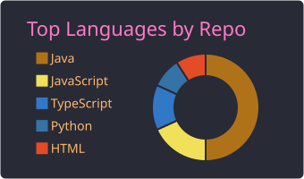
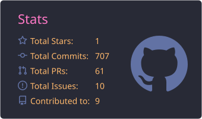

# Oii!! Me chamo Lucas Felipe :yum: / Hii!! My name is Lucas Felipe

Desenvolvedor full stack (Java, Spring Boot, React e Angular), estudante de Licenciatura em Ciência da Computação na UFPB e bolsista no [AYTY](https://ayty.org/), no projeto com a [Phoebus](https://www.phoebus.com.br/).  
Full stack developer (Java, Spring Boot, React and Angular), Computer Science student at UFPB and research fellow at [AYTY](https://ayty.org/), on the [Phoebus](https://www.phoebus.com.br/) project.

:smile: Pronouns: ele/dele | he/him

Projetos, tecnologias e experiência no portfólio / Projects, technologies and experience in my portfolio:

 

---

## Resumo/Overview

 

---

## Contatos/Contacts

 
